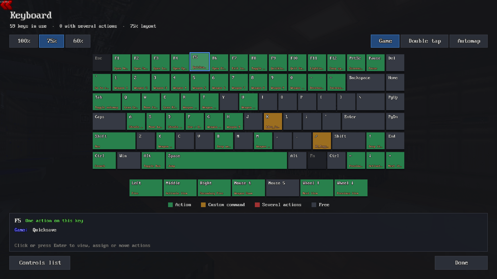

# Visual Keybinds for UZDoom

A mod for [UZDoom](https://github.com/UZDoom/UZDoom) that shows an **on-screen keyboard** with your key bindings. You can see what every key does and change it right there by clicking the key.

Inspired by the Minecraft mod **Studious Keybinds** by StudiousGoose. None of its code is used: this mod was written from scratch in ZScript.



## Where to find it

**Options > Controls > Visual keyboard**, the first entry in the menu.

From the console: `openmenu VKB_KeyboardMenu`

## Keyboard screen

- **100%** (104 keys), **75%** (84) and **60%** (61) layouts. Your choice is saved.
- Each key shows the name of its action at the bottom.
- An extra row with the **mouse buttons and wheel**.
- Switches between UZDoom's three binding sets: **Game**, **Double tap** and **Automap**.
- A panel shows what the selected key does in each set.

Key colors:

| Color | Meaning |
|---|---|
| Green | The key runs an action |
| Amber | Custom command (typed in the console, or from a mod without a menu) |
| Red | Several actions on the same key, e.g. `+attack; +use` |
| Gray | Free |

| Input | |
|---|---|
| Arrows / d-pad | Move between keys |
| `Enter` / click | Open the key editor |
| `PgUp` / `PgDn`, `LB` / `RB` | Switch Game / Double tap / Automap |
| `Home` / `End` | Switch keyboard size |

## Key editor

Tabs **On this key** and **All actions**. To find an action, just start typing (search matches names, categories and keys).

| Button | What it does |
|---|---|
| **Assign here** | Puts the selected action on this key |
| **Press a key…** | Puts the action on the next key or mouse button you press |
| **Unbind** | Removes the action from every key |
| **Default** | Gives only this action its default keys back |
| **Clear key** | Leaves this key free |

Changes apply right away, like in the stock controls menu.

## Mod actions

The list includes the actions from the game's controls menus and the ones mods add in their own menus inside Options. The **Default** button reads the same files UZDoom uses for `binddefaults`, including the `DEFBINDS` of loaded mods.

## Differences from Studious Keybinds

- In Doom a key runs a single binding. So red marks keys with **several commands combined**, instead of conflicts between actions.
- There are no `Shift`, `Ctrl` or `Alt` combinations, because UZDoom doesn't support them.
- `Esc` can't be bound: it always opens the menu.

## Requirements

UZDoom **5.0** or newer.

## Installing

1. Download the latest `.pk3` from [Releases](../../releases).
2. To load it with every game, put it in an autoload folder (`uzdoom.ini`, section `[global.Autoload]`, line `Path=...`), or load it with your other mods in your launcher.

## Languages

The mod's own text is in English and Portuguese. Action names come from UZDoom and from your mods, in whatever language the game is set to.

## Works with

[Tabbed Options](https://github.com/felipevfreitas/uzdoom-tabbed-options): with it, the visual keyboard shows at the top of the Controls tab.

## Building the .pk3

The mod's files are in `src/`. To pack them:

```
python build.py
```

The file is written to `dist/VisualKeybinds-<version>.pk3`.

The keyboard layouts (`src/zscript/vkb/layouts.zs`) are generated by `tools/genlayouts.py` from UZDoom's key name table:

```
python tools/genlayouts.py <UZDoom>/src/common/console/c_bind.cpp src/zscript/vkb/layouts.zs
```

## Changelog

- **1.0.0**: first release.
